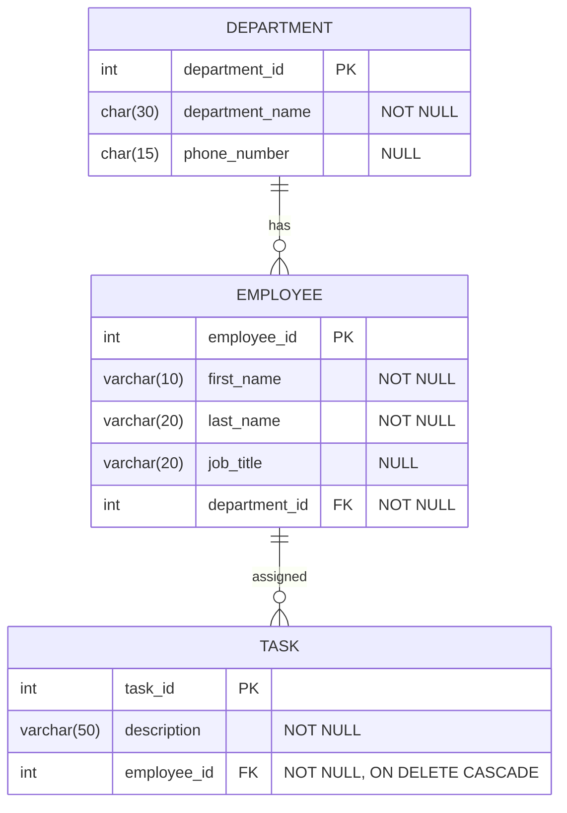

# Лабораторна робота №11: Databases

## Завдання:

**Робота з базами даних**

Створити реляційну базу даних та наповнити її даними



Створити програму, яка:

- встановлює з'єднання із створеною базою даних;
- виконує запити до бази даних:
    - отримати список всіх співробітників;
    - отримати список всіх завдань;
    - отримати список співробітників зазначеного відділу;
    - додати завдання для деякого співробітника;
    - для зазначеного співробітника отримати список його завдань;
    - видалити співробітника;
- виводить на консоль запитані дані.

## Інструкція з налаштування та запуску:

1. Склонуйте репозиторій

```bash
git clone https://github.com/lestaplus/java-labs.git
```

2. Перейдіть до теки лабораторної роботи

```bash
cd java-labs/lab11
```

3. Створіть базу даних у PostgreSQL:

```sql
create database company_db;
```

4. Скопіюйте файл прикладу `db.properties.example` у `db.properties`:

```bash
cp src/main/resources/db.properties.example src/main/resources/db.properties
```

5. Відкрийте `src/main/resources/db.properties` та вкажіть ваш пароль від PostgreSQL:

```properties
db.url=jdbc:postgresql://localhost:5432/company_db
db.user=postgres
db.password=your_password
```

6. Скомпілюйте та запустіть програму

```bash
mvn compile exec:java "-Dexec.mainClass=DatabaseQueries"
```